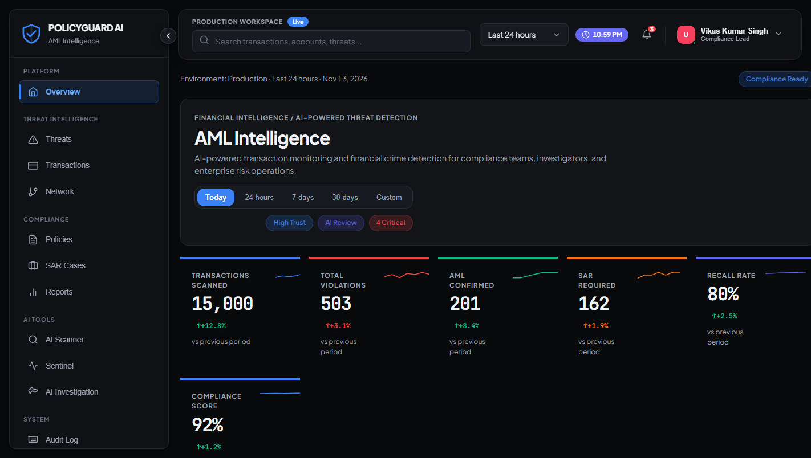
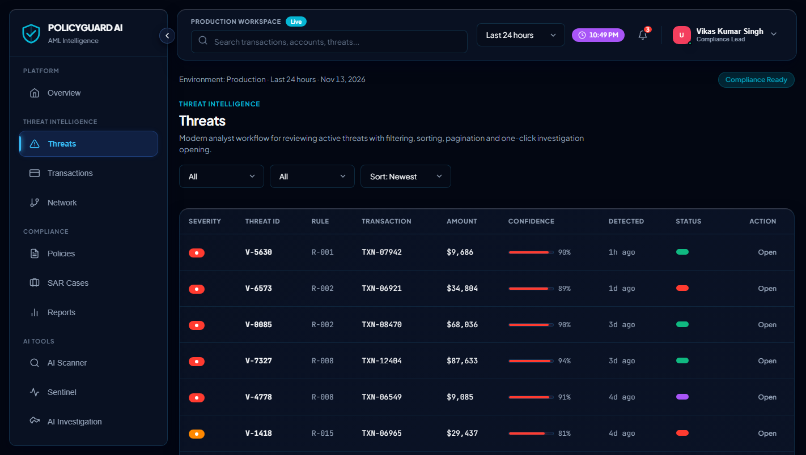
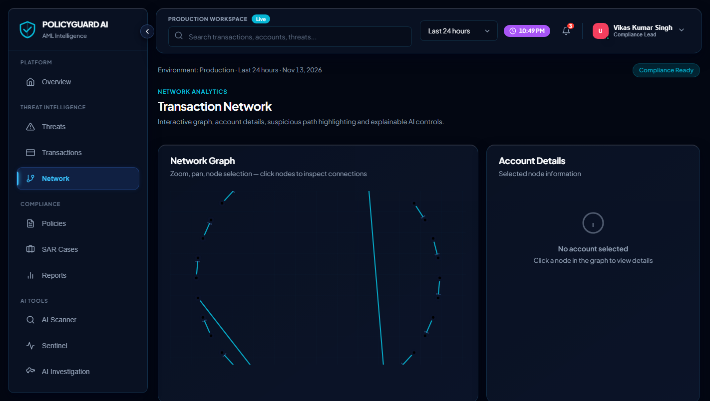
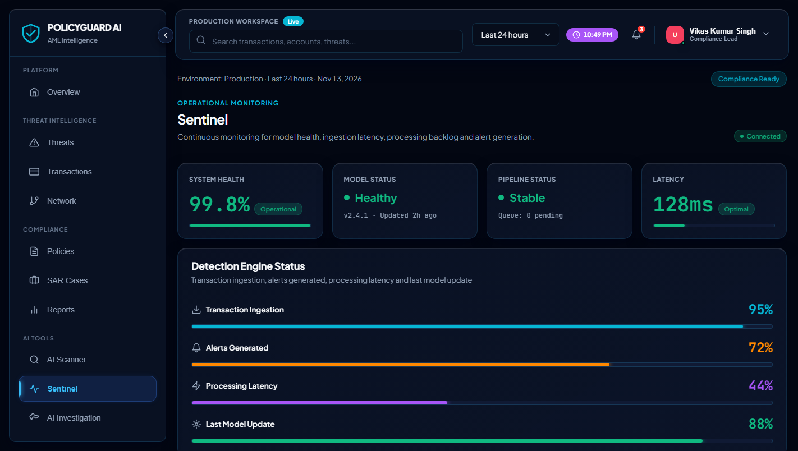
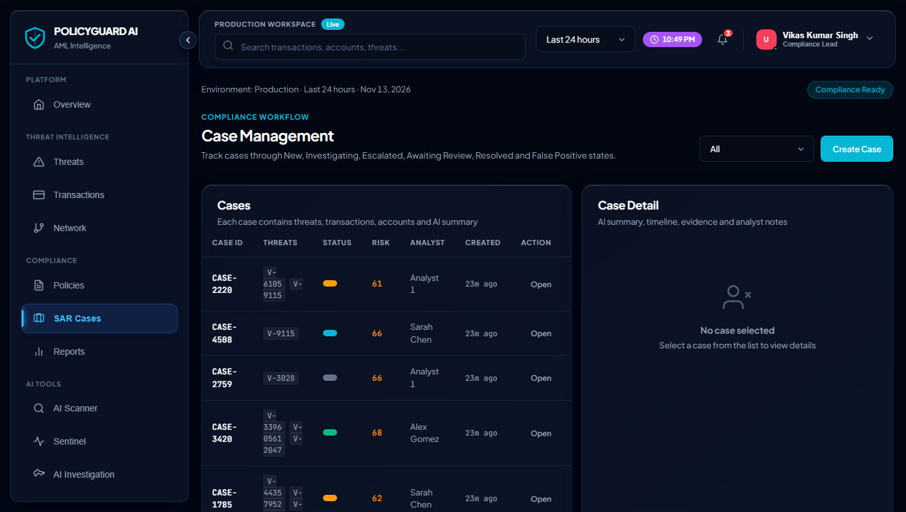

# PolicyGuard AML Intelligence Platform

PolicyGuard is an Anti-Money Laundering (AML) transaction monitoring, threat detection, and regulatory compliance platform. It equips compliance teams and financial intelligence analysts with real-time Change Data Capture (CDC) streaming, automated rule-based threat classification, topological fund-flow network analysis, and end-to-end Suspicious Activity Report (SAR) case management.

---

## Visual Overview

### Platform Overview Dashboard


### Threat Intelligence Registry


### Entity and Fund-Flow Network Graph


### Sentinel Real-Time CDC Feed


### SAR Case Management


---

## Core Capabilities

- **Sentinel Change Data Capture (CDC) Stream:** High-throughput transaction monitoring pipeline with WebSocket delivery, continuous latency tracking, and automated alert dispatch.
- **Rule-Based Threat Classification:** Configurable AML heuristics covering structuring, smurfing, rapid movement across high-risk corridors, round-amount anomalies, and velocity spikes.
- **Topological Network Analysis:** Canvas and SVG-based graph rendering identifying laundering rings, intermediary mule accounts, and layered fund paths.
- **SAR Case Management Workflow:** Full investigation lifecycle (New -> Investigating -> Escalated -> Resolved) with audit-trailed case notes and evidentiary attachments.
- **Automated Regulatory Reports:** Automated generation of FinCEN-compliant Suspicious Activity Reports with structured narrative summaries and export capabilities.
- **Role-Based Access Control (RBAC):** Token-based authentication (JWT) with bcrypt password hashing and tiered permissions across compliance lead, senior analyst, analyst, and admin roles.

---

## Technical Architecture

```text
+-------------------------------------------------------------------------+
|                              Client Layer                               |
|            React 19 SPA + Vite + React Router 7 + Canvas / SVG           |
+------------------------------------+------------------------------------+
                                     |
                                     | HTTP REST / WebSocket (Port 5173 -> 3001)
                                     v
+------------------------------------+------------------------------------+
|                             Backend API                                 |
|         Node.js + Express + Socket.IO + Zod Validation + Helmet         |
+------------------------------------+------------------------------------+
|                                    |                                    |
|         Authentication             |           Service Layer            |
|         - JWT Verification         |           - Threat Evaluation      |
|         - Role Enforcement         |           - Network Graph Builder  |
|         - Rate Limiter             |           - Live CDC Simulator     |
+------------------------------------+------------------------------------+
                                     |
                                     | better-sqlite3 (WAL Mode)
                                     v
+------------------------------------+------------------------------------+
|                            Database                                     |
|   SQLite: users, accounts, transactions, threats, rules, cases, logs    |
+-------------------------------------------------------------------------+
```

---

## Technology Stack

### Frontend
- **Framework:** React 19, React Router 7
- **Build Tool:** Vite 8
- **Styling:** Custom CSS variables, modular layout design tokens
- **Visualizations:** HTML5 Canvas, SVG graph projections

### Backend
- **Runtime:** Node.js 20+
- **HTTP Server:** Express 4
- **Real-Time Engine:** Socket.IO 4
- **Database:** SQLite via `better-sqlite3` with Write-Ahead Logging (WAL)
- **Validation:** Zod schemas
- **Security:** Helmet, CORS, bcryptjs, jsonwebtoken, IP rate limiting

### Testing and Tooling
- **Test Runner:** Node.js native test runner (`node:test`, `node:assert/strict`)
- **Linting:** ESLint 9

---

## Project Structure

```text
Policyguard-AML/
├── backend/
│   ├── data/
│   │   └── policyguard.db          # Pre-seeded SQLite database
│   ├── src/
│   │   ├── db/
│   │   │   ├── init.js             # Database connection, schemas, and views
│   │   │   └── seed.js             # Deterministic data generation script
│   │   ├── middleware/
│   │   │   ├── auth.js             # JWT authentication and authorization
│   │   │   ├── errorHandler.js     # Centralized error and 404 handlers
│   │   │   └── rateLimiter.js      # Window-based IP rate limiting
│   │   ├── routes/
│   │   │   ├── audit.js            # Audit log queries
│   │   │   ├── auth.js             # Login, register, profile
│   │   │   ├── cases.js            # SAR case CRUD and status workflows
│   │   │   ├── network.js          # Graph nodes and edges for network view
│   │   │   ├── reports.js          # Compliance report generation
│   │   │   ├── rules.js            # AML detection rule configuration
│   │   │   ├── scans.js            # Batch scanning job execution
│   │   │   ├── stats.js            # Metrics and analytical aggregations
│   │   │   ├── threats.js          # Threat registry and bulk remediation
│   │   │   └── transactions.js     # Transaction filters and pagination
│   │   ├── services/
│   │   │   └── websocket.js        # Real-time event broadcasting
│   │   └── index.js                # Server entry point
│   ├── test/
│   │   └── api.test.js             # Integration and schema test suite
│   └── package.json
├── docs/
│   └── screenshots/                # Application interface captures
├── src/
│   ├── components/
│   │   ├── layout/                 # Topbar, Sidebar, Navigation
│   │   ├── ui/                     # Primitives (Button, Card, Badge, Input)
│   │   └── shared.jsx              # Shared view components
│   ├── contexts/
│   │   └── AuthContext.jsx         # Client authentication state
│   ├── services/
│   │   └── api.js                  # Centralized HTTP client
│   ├── theme/
│   │   └── colors.js               # Theme tokens and utility formatters
│   ├── views/                      # Application view pages
│   ├── App.jsx                     # Root application routing
│   ├── index.css                   # Global styles and design system variables
│   └── main.jsx                    # Application entry point
├── package.json
└── vite.config.js
```

---

## API Reference

| Endpoint | Method | Description | Auth Required |
|---|---|---|---|
| `/health` | GET | Server health, uptime, and version status | No |
| `/api/auth/login` | POST | Authenticate user and receive JWT | No |
| `/api/auth/me` | GET | Retrieve authenticated profile | Yes |
| `/api/stats/overview` | GET | Aggregate metrics, risk distributions, and alerts | Yes |
| `/api/threats` | GET | Paginated threat registry with severity filters | Yes |
| `/api/threats/:threatId` | GET | Detailed threat record with related transactions | Yes |
| `/api/threats/bulk-action` | POST | Bulk status update and remediation | Yes |
| `/api/transactions` | GET | Filtered transaction list with laundering flags | Yes |
| `/api/network` | GET | Entity nodes and transaction edges for graph rendering | Yes |
| `/api/cases` | GET / POST | Retrieve and create SAR investigation cases | Yes |
| `/api/cases/:caseId` | PUT | Update case status, risk score, and analyst notes | Yes |
| `/api/reports` | GET / POST | List and generate compliance reports | Yes |
| `/api/rules` | GET / PUT | List detection rules and toggle active state | Yes |
| `/api/scans/start` | POST | Trigger batch table inspection job | Yes |
| `/api/audit` | GET | Historical audit log entries | Yes |

---

## Getting Started

### Prerequisites
- Node.js 20.0.0 or higher
- npm 10.0.0 or higher

### Installation

1. **Clone the repository:**
   ```bash
   git clone https://github.com/Mrvikas06/Policyguard-AML.git
   cd Policyguard-AML
   ```

2. **Install frontend and backend dependencies:**
   ```bash
   npm install
   npm --prefix backend install
   ```

3. **Database Seeding (Optional):**
   The repository includes a populated SQLite database at `backend/data/policyguard.db`. To regenerate sample data:
   ```bash
   npm --prefix backend run seed
   ```

4. **Start the backend server:**
   ```bash
   cd backend
   npm run dev
   # Runs on http://localhost:3001
   ```

5. **Start the frontend application:**
   In a separate terminal:
   ```bash
   npm run dev
   # Runs on http://localhost:5173
   ```

---

## Demo Credentials

The seeded database contains pre-configured user accounts for testing:

| Email | Role | Password |
|---|---|---|
| `vikas@policyguard.ai` | Compliance Lead | `password123` |
| `admin@policyguard.ai` | System Administrator | `password123` |
| `senior.analyst@policyguard.ai` | Senior Analyst | `password123` |
| `analyst1@policyguard.ai` | AML Analyst | `password123` |

---

## Testing and Verification

Run the automated test suite:
```bash
npm test
```

Run code formatting and style checks:
```bash
npm run lint
```

Create production build:
```bash
npm run build
```

---

## License

This project is licensed under the MIT License.
